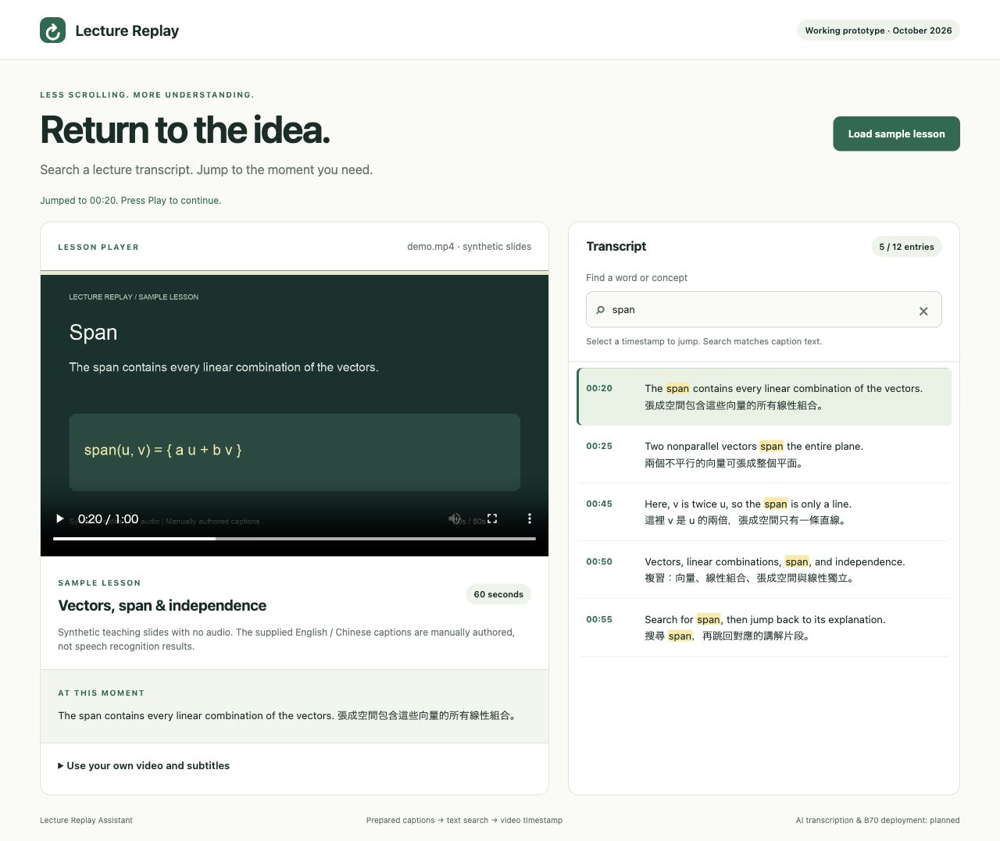

# Lecture Replay Assistant

Lecture Replay Assistant provides a searchable workspace for recorded lessons. Students can find a topic in the transcript, inspect its source caption, and return directly to the corresponding moment in the video.



## Features

- Video playback with pause and timeline controls.
- Timestamped SRT captions with current-caption synchronization.
- Case-insensitive English search and Chinese keyword matching.
- Search results that link directly to the video timeline.
- Local video and subtitle import, with files processed in the browser.
- Input validation and recoverable subtitle errors.

## Getting started

Requirements: Python 3 and a browser that supports H.264 MP4 playback.

From the repository directory, start the local server:

```sh
python3 tools/serve.py
```

Open <http://127.0.0.1:8000>. The included lesson loads automatically. The server supports HTTP byte ranges for video navigation.

To use a different port:

```sh
python3 tools/serve.py --port 8001
```

## Exploring a lesson

Search for `span` and select the `00:20` result to revisit the explanation. Search for `VECTOR` or `向量` to explore English and Chinese captions. Clear the search to return to the complete transcript.

To review another lesson, expand **Use your own video and subtitles** and select a browser-supported video with its matching UTF-8 SRT file. Selecting a caption preserves the player's play or pause state. Local files stay in the browser.

## Architecture

```text
Video ───────────────────────────────> HTML video player
SRT captions -> timing validation -> transcript search -> timestamp navigation
```

| Component | Responsibility |
| --- | --- |
| `core.mjs` | SRT parsing, caption search and time formatting |
| `app.mjs` | Transcript rendering and player synchronization |
| `index.html`, `style.css` | Review workspace and responsive layout |
| `tools/serve.py` | Local static hosting with HTTP byte-range support |

Caption rendering uses DOM text nodes. Search matches the supplied caption text; source timestamps remain available for checking the corresponding lesson content.

## Demonstration and documentation

- [Application demonstration on YouTube](https://youtu.be/zAp_sbnWf2w)
- [Proposal slide deck (PDF)](docs/Lecture_Replay_Assistant_Proposal.pdf)
- [English-captioned application walkthrough](docs/demo-walkthrough.mp4)
- [Verification record](docs/validation.md)
- [Sample asset provenance](assets/README.md)

The sample is a 60-second illustrated lesson with manually authored English and Chinese captions and no audio. The application walkthrough presents captured interface states with English explanations.

## Tests

Data tests use Node.js 18+ and its built-in test runner:

```sh
node --test tests/core.test.mjs
```

The verification record documents parser and search tests, browser playback and navigation checks, and the coverage of the included sample.

## Development roadmap

Planned extensions include speech transcription, semantic concept indexing, board-assisted context, and inference integration with Intel Arc Pro B70. These stages will be evaluated using source-aligned captions, explanation intervals and hardware measurements.

## License

Application source: [MIT](LICENSE). Original sample assets: [CC0 1.0](assets/README.md).
